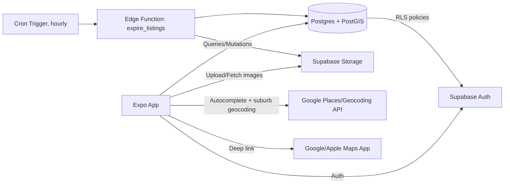

# GarageMate — Technical Architecture

**Version:** 1.1 (final draft for build)

## 1. Stack Summary

| Layer | Choice | Why |
|---|---|---|
| App framework | Expo (React Native + TypeScript) | Single codebase for iOS/Android, OTA updates, mature ecosystem |
| Backend | Supabase | Postgres + PostGIS gives native radius queries; also bundles auth, storage, RLS, scheduled functions |
| Database | Postgres w/ PostGIS extension | Geo queries (`ST_DWithin`) beat Firestore geohash hacks for radius search |
| Auth | Supabase Auth | Google, email/password, password reset, email verification now; Apple Sign-In added once Apple Developer account is obtained (see Product Spec §0) |
| Storage | Supabase Storage | Listing images (max 3 per listing) |
| Maps | `react-native-maps` | Apple Maps on iOS, Google Maps on Android, matches native deep-link requirement |
| Address autocomplete & suburb geocoding | Google Places Autocomplete + Geocoding API | Predictive address search for AddView, and resolving a typed suburb name to lat/lng for the required suburb-search fallback |
| Data fetching | TanStack Query + `@supabase/supabase-js` | Caching, refetch-on-focus, optimistic updates for save/unsave |
| Navigation | React Navigation (bottom tabs + stack) | Maps to nav bar: Home / Map / Saved / Add / Profile |
| Scheduled cleanup | Supabase Edge Function + Cron Trigger | Hard-deletes expired listings (see §4) |

## 2. System Architecture



## 3. Data Model

```sql
-- Users are managed by Supabase Auth (auth.users). Extend with a profile table.
create table profiles (
  id uuid primary key references auth.users(id) on delete cascade,
  display_name text not null,
  created_at timestamptz not null default now()
);

create extension if not exists postgis;

create table listings (
  id uuid primary key default gen_random_uuid(),
  owner_id uuid not null references profiles(id) on delete cascade,
  title text not null,
  description text not null,
  address text not null,
  location geography(Point, 4326) not null,
  date_start date not null,
  time_start time not null,
  time_end time not null,
  date_end date,               -- optional second day
  time_start_2 time,
  time_end_2 time,
  -- Computed client-side at creation: whichever is later of (date_end, time_end_2)
  -- if a second day exists, else (date_start, time_end). Device-local time at creation.
  -- Drives both "is this still active" queries and the auto-delete sweep.
  end_at timestamptz not null,
  created_at timestamptz not null default now()
);

create index listings_location_idx on listings using gist (location);
create index listings_end_at_idx on listings (end_at);

create table listing_images (
  id uuid primary key default gen_random_uuid(),
  listing_id uuid not null references listings(id) on delete cascade,
  storage_path text not null,
  position smallint not null check (position between 0 and 2)
);

create table saved_listings (
  user_id uuid not null references profiles(id) on delete cascade,
  listing_id uuid not null references listings(id) on delete cascade,
  saved_at timestamptz not null default now(),
  primary key (user_id, listing_id)
);
```

Note: there's no `is_active` boolean. "Active" is simply `end_at >= now()`, and expired rows are physically deleted by the cleanup job (§4) rather than flagged — so the column would just go stale.

## 4. Listing Expiry — Auto-Delete Job

Resolved design: a Supabase Edge Function, invoked hourly by a Cron Trigger, hard-deletes listings whose `end_at` has passed.

```ts
// supabase/functions/expire_listings/index.ts
import { createClient } from "@supabase/supabase-js";

Deno.serve(async () => {
  const supabase = createClient(
    Deno.env.get("SUPABASE_URL")!,
    Deno.env.get("SUPABASE_SERVICE_ROLE_KEY")! // service role: bypasses RLS for cleanup
  );

  const { data: expired, error } = await supabase
    .from("listings")
    .select("id, listing_images(storage_path)")
    .lt("end_at", new Date().toISOString());

  if (error) throw error;
  if (!expired?.length) return new Response("no expired listings");

  for (const listing of expired) {
    const paths = listing.listing_images.map((img: { storage_path: string }) => img.storage_path);
    if (paths.length) {
      await supabase.storage.from("listing-images").remove(paths);
    }
  }

  const ids = expired.map((l) => l.id);
  // Cascades to listing_images and saved_listings automatically.
  const { error: delError } = await supabase.from("listings").delete().in("id", ids);
  if (delError) throw delError;

  return new Response(`deleted ${ids.length} expired listings`);
});
```

Cron Trigger config (`supabase/config.toml` or dashboard): run every hour. Hourly is granular enough for a garage-sale end time without needing per-minute precision, and keeps function invocations cheap.

Client-side, computing `end_at` at creation (React Native / device-local time):

```ts
const endDate = hasSecondDay ? dateEnd : dateStart;
const endTime = hasSecondDay ? timeEnd2 : timeEnd;
const endAt = new Date(
  endDate.getFullYear(), endDate.getMonth(), endDate.getDate(),
  endTime.getHours(), endTime.getMinutes()
); // device-local Date, serializes to correct UTC instant on insert
```

## 5. Key Query Patterns

### 5.1 Radius search (HomeView list filter)

```sql
select *,
  st_distance(location, st_setsrid(st_makepoint(:lng, :lat), 4326)::geography) as distance_m
from listings
where end_at >= now()
  and st_dwithin(location, st_setsrid(st_makepoint(:lng, :lat), 4326)::geography, :radius_m)
  and date_start >= :date_filter_start
  and date_start <= :date_filter_end
order by distance_m asc;
```

Exposed via a Postgres RPC function (`nearby_listings(lat, lng, radius_m, date_from, date_to)`) called through `supabase.rpc(...)` — keeps the geo math server-side.

### 5.2 Suburb search fallback

Since suburb search is a required path (not optional), it shares the same `nearby_listings` RPC — the only difference is where `lat`/`lng` come from:

1. User denies location permission, or opts to type a suburb.
2. App calls Google Geocoding API with the typed suburb text → gets a centroid lat/lng.
3. That lat/lng feeds the same `nearby_listings(lat, lng, radius_m, ...)` call used for GPS-based search — no separate query path to maintain.

### 5.3 Map viewport load/unload

On `onRegionChangeComplete`, compute the bounding box of the visible map region and query:

```sql
select id, title, st_x(location::geometry) as lng, st_y(location::geometry) as lat
from listings
where end_at >= now()
  and location && st_makeenvelope(:min_lng, :min_lat, :max_lng, :max_lat, 4326)::geography;
```

Debounce this call (~300ms after pan/zoom settles) and diff against currently-rendered annotation IDs to add/remove markers rather than re-rendering the whole set.

## 6. Auth Flow

- Supabase Auth handles Google OAuth and email/password natively; Apple OAuth added once the Apple Developer account exists.
- On email/password registration: collect first + last name → write to `profiles.display_name` on trigger (`on auth.users insert`) → Supabase sends verification email → block app entry until `email_confirmed_at` is set.
- Password reset: Supabase's built-in reset-by-email flow, deep-linked back into the app.

## 7. Security (Row-Level Security)

```sql
alter table listings enable row level security;
alter table saved_listings enable row level security;

-- Anyone can read non-expired listings; owners can also see their own (covers the brief
-- window between expiry and the next hourly cleanup run)
create policy "public read active listings" on listings
  for select using (end_at >= now() or owner_id = auth.uid());

-- Only owner can insert/update/delete their own listings
create policy "owner writes own listings" on listings
  for all using (owner_id = auth.uid()) with check (owner_id = auth.uid());

-- Users manage only their own saved listings
create policy "user manages own saves" on saved_listings
  for all using (user_id = auth.uid()) with check (user_id = auth.uid());
```

## 8. Image Handling

- `expo-image-picker` for selection, `expo-image-manipulator` to resize/compress before upload (cap ~1600px longest edge, JPEG quality ~0.7).
- Upload to Supabase Storage under `listings/{listing_id}/{position}.jpg`.
- `listing_images.position` (0–2) drives carousel order in Detail View.

## 9. Native Maps Deep Link

```ts
const url = Platform.select({
  ios: `maps://?address=${encodedAddress}`,
  android: `geo:0,0?q=${encodedAddress}`,
});
Linking.openURL(url);
```
Fallback to a Google Maps web URL if the native scheme fails to open.

## 10. Deployment / CI

- EAS Build for iOS/Android binaries.
- EAS Update for OTA JS bundle pushes (skip store review for non-native changes).
- Supabase migrations tracked in repo via `supabase/migrations`, applied through Supabase CLI in CI.
- iOS App Store submission gated on Apple Developer account + Apple Sign-In implementation (Guideline 4.8, see Product Spec §0). Android release and internal iOS TestFlight builds are not blocked by this.

## 11. Remaining Risks

- PostGIS query performance at scale — fine for MVP volumes, revisit indexing if listing count grows into the hundreds of thousands.
- Google Places Autocomplete + Geocoding both bill per-request — debounce input and cap session tokens to control cost, especially since suburb search is now a required (likely heavily used) path.
- `end_at` computed from device-local time at creation means a seller traveling in a different time zone from the sale location could get a slightly off expiry; acceptable edge case for v1.
